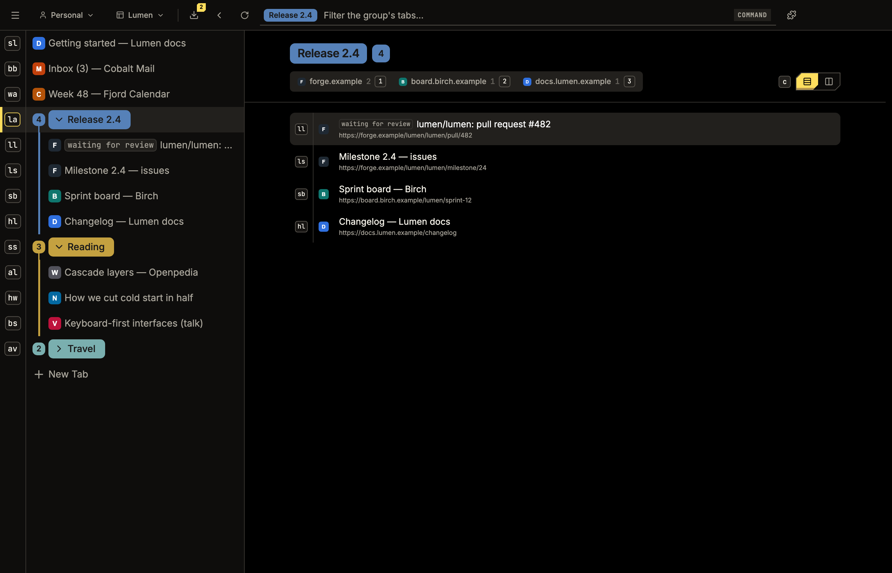
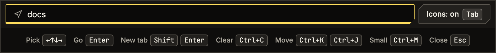
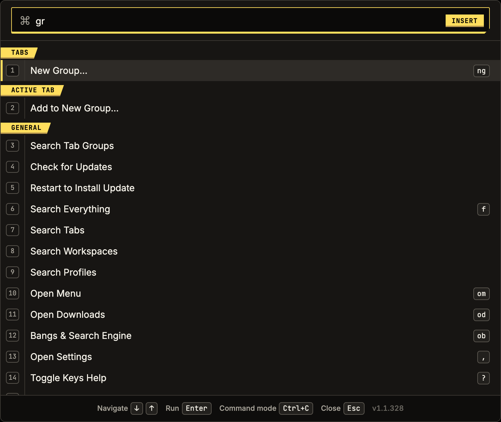
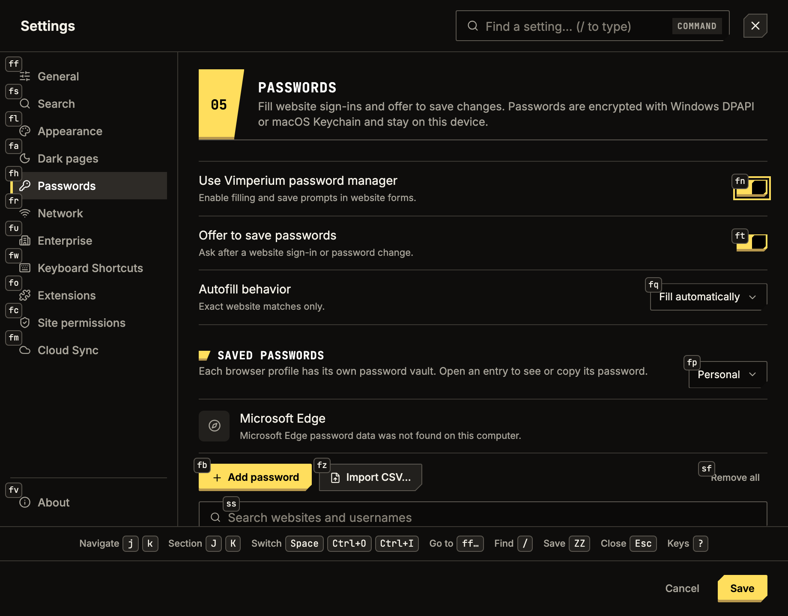
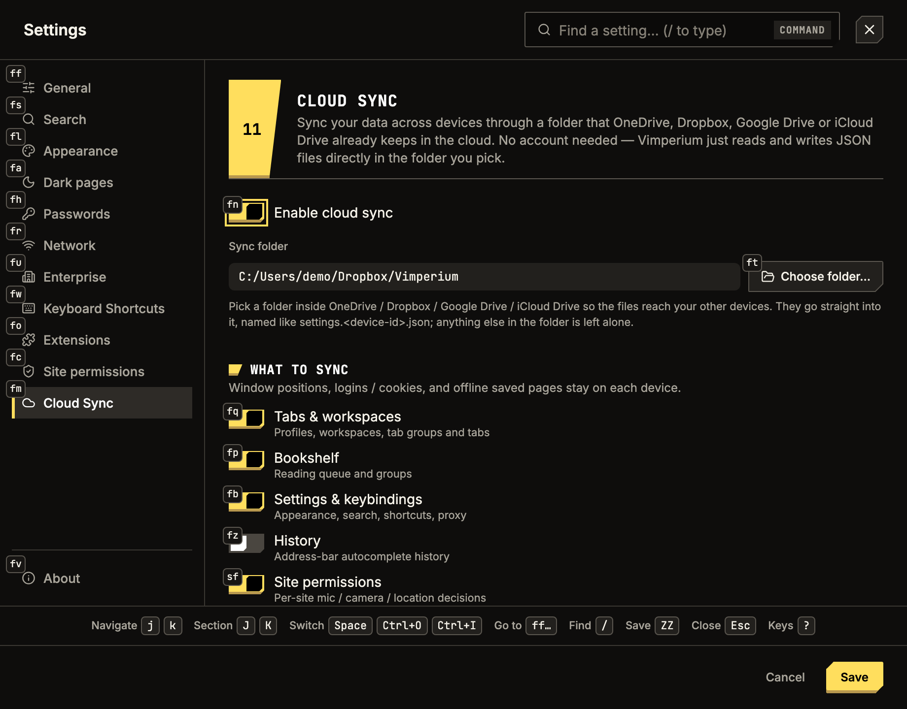
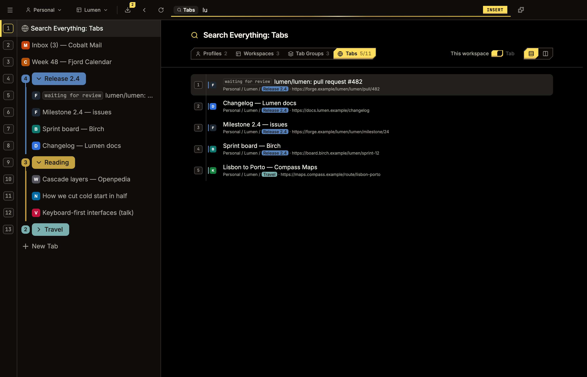
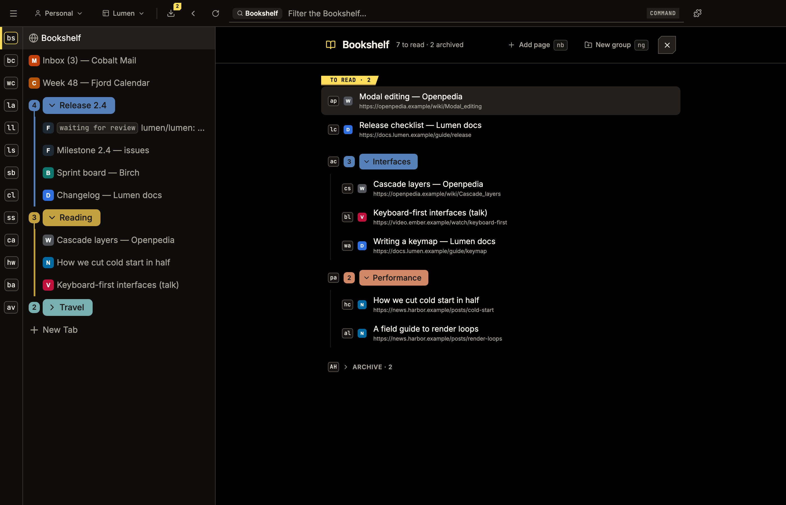

# Vimperium

A desktop browser for navigating pages and workspaces with Vim keys. Tabs live in colour-coded groups, groups in workspaces, workspaces in isolated profiles — and all of it is driven without the mouse.

## Highlights

- Type a few letters to find a tab, open a link or run a browser command.
- Keep each project in its own workspace and use profiles for separate sign-ins.
- Carry tabs, bookmarks and key bindings between machines with a cloud folder you control.

## Feature tour

### Tab groups

Open a group to see its tabs together. Filter by title in the address bar, then type a row’s label to switch to that tab.



### Go

Press `Space` and type the words on a link or button. Move between matches with the arrow keys, then press `Enter` to activate one.



### Command Palette

Press `Ctrl+p` and type part of an action’s name. The results include its shortcut, so you can learn the binding as you go.



### Passwords and passkeys

Save sign-ins per profile, autofill forms and import passwords from CSV or Edge. On macOS, Vimperium can also act as a passkey authenticator.



### Cloud Sync

Choose a folder on your own cloud drive. Share workspaces, the Bookshelf and key bindings across machines, and choose which categories each device syncs.



### Search Everything

Press `f` to search tabs, groups and workspaces together. Press `Tab` to widen your search to other workspaces.



### Bookshelf

Save the current tab to your reading list with `nb`. Open the Bookshelf with `tb` to browse groups, find the next article or archive one you have finished.



## Features

The sections below document the full feature set. The introduction, Highlights and illustrated Feature tour above also supply the product page on bedware.software.

### Vim modes

Two modes, COMMAND and INSERT, and no regular-shortcuts mode to fall back to. In COMMAND the keys are commands for the page and the browser; in INSERT they go to the page or the field you type in. `i` goes into INSERT, `Esc` or `Ctrl+[` comes back; clicking a text field is INSERT, anywhere else COMMAND. The system's copy, paste and undo work as ever.

### Vim keys

COMMAND reads like vim: `j`/`k` scroll, `Ctrl+d`/`Ctrl+u` move half a page, `gg`/`G` jump to the ends, `Ctrl+o`/`Ctrl+i` go back and forward. A count goes first (`5j`, `3x`) and `.` repeats the last change. A letter that starts a pair is a verb: `n` new (`nt` tab, `ng` group, `nw` workspace, `np` profile), `d` delete (`dd` tab, `dg` group, `dw` workspace, `dD` duplicate tabs), `o` open (`od` Downloads, `ob` Bangs, `om` the menu), `t` toggle (`ts` the Sidebar, `tb` the Bookshelf). `x` closes a tab and `u` brings back what was closed. Keys go by position on the keyboard, so they work in any input language.

### Mode indicator

The toolbar shows the mode in full, COMMAND or INSERT, in one of two looks (Quiet, Outline). In INSERT the address bar's underline turns yellow with a glint running along it, and so can the field of every popup; Settings → Appearance sets the look, the glint's pace, or turns it off.

### Keymap editor

Every binding is a line of text in Settings → Keyboard Shortcuts: a command and its keys, sequences and Ctrl chords included. A saved keymap is carried over when the defaults change, keeping the keys its owner rebound. `?` opens the Keys page — every key, by section, with a filter.

### Which-key hints

A prefix waits for its next key with no timeout, and a strip at the bottom of the window lists what can follow it. Pages and popups show a hint bar with their main keys.

### Labels

In COMMAND every row of the Sidebar, of a list page, of the Command Palette and of the pickers wears a label of one to three letters; typing it picks the row. The part typed so far is highlighted and the rows that no longer match fade.

### Go

`Space` opens a box low in the window that finds the page's links, buttons and tabs by what is typed. Every match lights up, the arrows move the pick and `Enter` presses it as a mouse would; the box stays for the next one. Latin letters find Cyrillic text too, also when typed on the wrong layout, and spaces needn't be typed. `Tab` includes icon-only controls by their title; `Ctrl+K`/`Ctrl+J` move the box up and down, `Ctrl+M` shrinks it.

### Text field picker

`gi` outlines the page's text fields: `h`/`j`/`k`/`l` or `Tab` pick one, `Enter` types into it. A field a page focuses by itself doesn't take the keys unless Settings says it may.

### Sidebar

Tabs and groups in one column, each row with its label. The arrows move a cursor without showing anything and `Enter` shows the row picked; `Shift+↓/↑` pick several rows; `←`/`→` fold and unfold a group; `Ctrl+j`/`Ctrl+k` carry the tab or group up and down; `m` opens the row's menu. `Tab` shows or hides the Sidebar, and it can hide by itself in INSERT. A row shows a speaker on a tab playing sound and the interval on one that reloads by itself.

### Tab groups

Colour-coded, collapsible groups with drag-and-drop reordering. Parking on a group shows its tabs as a page, in one column or two, with the address bar as its filter. Groups can be renamed, moved to another workspace, duplicated and ungrouped.

### Workspaces

Independent sets of tabs and groups — work, personal, a project — each in a window of its own. Workspaces can be renamed, closed, deleted, exported to a file and imported back; importing also takes tab groups from a browser's exported bookmarks.

### Profiles

Separate session partitions keep cookies, logins, passwords and the Bookshelf apart. A new profile opens in a window of its own.

### Search Everything

`f` opens a page that fuzzy-searches tabs, groups, workspaces and profiles, in this workspace or in all of them (`Tab` flips the scope). The address bar is its box; `t` `w` `g` `p` pick the kind. Settings → Search picks which fields it goes by.

### Command Palette

`Ctrl+p` or `:` fuzzy-searches every command of the app and runs the one picked.

### Address bar

The address bar has no frame, only a line under it. `e` types in it with the address in place. It suggests from history, past searches and the search engine, with inline completion. On a page the app draws itself it is that page's filter. The padlock shows the site's certificate; a site that isn't secure says so in red.

### Address editor

`E` shows the page's title and its address big, cut into blocks with a key each: protocol, domain, port, the path's levels, parameters, fragment. An intent and a block's key act on that block — `c` changes it, `d` removes it, `y` copies it, `p` pastes over it; `gu` goes up a level, `gt` keeps only the site, `u` undoes. `Enter` goes there, `Shift+Enter` in a new tab.

### Bangs

`!w vim` in the address bar opens that site's own search straight away, from a table of bangs kept in the browser. The Bangs page (`ob`) lists them: add, edit, switch off, delete with undo, sort, and pick the default search engine or a custom one.

### Find in page

`/` finds text in the page; `n`/`N` or `j`/`k` step through the matches, and `Enter` clicks the match when it is on a link or a button.

### Split view

`V` puts a second pane on the right, `S` below, with a picker of the workspace's tabs for it. `Ctrl+w w` moves between the panes, the divider drags, `q` ends the split.

### Downloads

`od` opens the list of downloads: open the file, show it in its folder, copy the link, pause, resume, retry, remove with undo, sort and filter.

### Bookshelf

`tb` opens the profile's reading list: readings to read, in groups if you like, and an archive of the ones read. `nb` puts the current tab on the shelf.

### Tab comments

`gcc` annotates a tab with a short note, shown on its row.

### Auto reload

`R` makes a tab reload by itself — every second, 5, 10… or an interval of your own — and `R` again stops it.

### Page keys

`+` and `-` zoom the page, `=` resets it. `]]` and `[[` follow the page's own next and previous links; `Ctrl+a` and `Ctrl+x` add one to the last number in the address and take one off. `Ctrl+v` hands the next key to the page, for a site with shortcuts of its own. `y` copies the address, `P` opens the copied one in a new tab. `Ctrl+6` goes back to the tab you were on before.

### Dark pages

A built-in dark mode for web pages: Chromium darkens each page as it paints — no white flash, frames included — and a site with a dark theme of its own shows it. `D` switches it for the site; the moon in the address bar sets brightness, contrast and warmth, and Settings keeps the per-site rules.

### Themes

Dark, light or the system's. The light theme is white, with yellow plates as in the dark one, and has a choice of backgrounds: White, Paper, Paper soft, Steel, Stone; the dark theme has a softer step. Typing in the address bar turns the whole bar yellow in the light theme, and lights a yellow line under it in the dark one. Animations can be reduced. Colours, fonts and controls come from the bedware design system.

### Passwords and passkeys

A built-in password manager per profile: it offers to save sign-ins, fills them in, and imports from a CSV file or from Microsoft Edge. On macOS Vimperium is its own passkey authenticator, and Settings lists the passkeys it keeps.

### Extensions

Chrome extensions install from the Chrome Web Store or Edge Add-ons, by link or id. Their buttons, popups, side panels and shortcuts work, and `oe` opens their menu from the keyboard.

### Site permissions

Camera, microphone, location, notifications, clipboard and MIDI devices have a default each, and per-site exceptions.

### Cloud Sync

Tabs and workspaces, the Bookshelf, settings and keys, history, site permissions, extensions and dark pages sync through a folder of your own cloud drive (OneDrive, Dropbox, iCloud, Google Drive) — each kind switched on separately.

### Network and enterprise

A proxy (the system's, none, or your own with a bypass list), DNS-over-HTTPS, and Integrated Windows Authentication (NTLM / Kerberos) for an allowlist of hosts.

### Default browser

Vimperium can be the system's default browser. A link another app hands over opens a page that asks where to put it — a workspace, a group — or passes it on to another browser.

### Updates

The app checks for a new version, shows a toast when one is ready and installs it on request.

## Tech stack

Electron 41 · React 19 · TypeScript · Vite · Tailwind CSS · Zustand · dnd-kit · @bedware/ui

## Getting started

```bash
npm install
npm run dev
```

- `npm run screenshots -- --site` builds the renderer and refreshes the frames linked under Feature tour: dark in `docs/screenshots/`, light in `docs/screenshots/light/`. It opens the built renderer in headless Chromium (Playwright) with sample data; Vimperium itself is not started and no window appears. Commit those images with this README. bedware.software reads the introduction, Highlights bullets and Feature tour sections on its next build.

## Building

```bash
npm run dist:win    # Windows installer
npm run dist:mac    # macOS dmg
npm run dist:linux  # Linux AppImage
```
